<div align="center">




<br/>

<a href="https://www.linkedin.com/in/gabriel-harnagea/"></a>&nbsp;<a href="mailto:gabriel.harnagea06@gmail.com"></a>&nbsp;

<br/>



<br/>

&nbsp;<a href="README.it.md"></a>

</div>


## `▸` About

I'm a DevOps & Platform Engineer on enterprise projects: CI/CD, Kubernetes, Terraform, cloud cost.

I wrote application code before I ran the infrastructure that hosts it, which pays off mostly when a build breaks and someone has to know where to look.

The open-source work here comes from the same place. Most of it is small, read-only, deterministic tools for problems I hit in real deployments, and when the bug is in someone else's code the fix goes upstream rather than into a patch I keep for myself.

```yaml
role:      DevOps & Platform Engineer
building:  [trasloco, kubectl-safe-rollout, scadenza, disdetta]
platform:  [Azure, Kubernetes, GitOps, Terraform, Azure DevOps, GitHub Actions]
also:      [FinOps, Agentic DevOps, .NET backend]
languages: [C#, TypeScript, Go, Rust, Python, Bash, PowerShell]
into:      [correctness bugs, observability gaps, release plumbing, cloud cost]
based_in:  Turin, Italy
```


## `▸` Projects

### [trasloco](https://github.com/HarnageaGabriel/trasloco)

An open-source tool, in the making, to move CI/CD pipelines between Azure DevOps, GitHub and more. Predictable and reviewable by design: plan/apply, deterministic.

Already usable today to find retired Azure Pipelines tasks, as shown in its [Try it now](https://github.com/HarnageaGabriel/trasloco#try-it-now-find-retired-azure-pipelines-tasks) section. The companion repo [trasloco-e2e](https://github.com/HarnageaGabriel/trasloco-e2e) runs the generated pipelines on real runners.

  

| | Project | What it is | Stack | Status |
|:-:|---|---|---|:-:|
|  | **[kubectl-safe-rollout](https://github.com/HarnageaGabriel/kubectl-safe-rollout)** | A kubectl plugin that explains why a rollout failed or stalled: deterministic classification, no LLM, and it never writes to the cluster | `Go` `client-go` |  |
|  | **[scadenza](https://github.com/HarnageaGabriel/scadenza)** | Which public TLS certificates will not survive 100-day lifetimes. It merges Certificate Transparency logs, live TLS handshakes, Kubernetes/cert-manager and Azure Key Vault into one inventory: where each certificate lives, who renews it, and whether renewal is automatic. Read-only | `Go` |  |
|  | **[disdetta](https://github.com/HarnageaGabriel/disdetta)** | Finds Bitnami dependencies (bitnamilegacy images, since 2025-08-28) in repositories, clusters and GitOps repos, then plans the exit per component. Read-only, deterministic, no telemetry | `Go` |  |
|  | **[github-actions-recipes](https://github.com/HarnageaGabriel/github-actions-recipes)** | The workflows behind my CI/CD and FinOps posts, one variable isolated per recipe | `GitHub Actions` |  |
|  | **[token-optimization](https://github.com/HarnageaGabriel/token-optimization)** | Idempotent bootstrap that cuts token usage when working with LLM coding agents | `PowerShell` |  |

The Go tools here share one shape: single binary, read-only by default, deterministic, no telemetry, Apache-2.0.

`kubectl-safe-rollout` is [submitted to krew-index](https://github.com/kubernetes-sigs/krew-index/pull/6213), so it will be installable with `kubectl krew install safe-rollout`.


## `▸` What I do

<table>
<tr>
<td align="center" width="16.6%"><br/><b>Pipelines</b><br/><sub>Azure DevOps · GitHub Actions · templates</sub></td>
<td align="center" width="16.6%"><br/><b>Kubernetes</b><br/><sub>AKS · k3d · Helm · Helmfile</sub></td>
<td align="center" width="16.6%"><br/><b>Infrastructure</b><br/><sub>Terraform · scale sets · golden images</sub></td>
<td align="center" width="16.6%"><br/><b>Containers</b><br/><sub>Docker · Helm charts · OCI on ACR/GHCR</sub></td>
<td align="center" width="16.6%"><br/><b>Cloud &amp; cost</b><br/><sub>Azure · reservations · FinOps</sub></td>
<td align="center" width="16.6%"><br/><b>Backend</b><br/><sub>.NET 8/9 · CQRS · DDD</sub></td>
</tr>
</table>


## `▸` Stack

<div align="center">


</div>

<table>
<tr>
<td width="50%" valign="top">

**Platform &amp; CI/CD**  
Azure DevOps YAML pipelines and reusable templates · GitHub Actions · Helm charts and Helmfile releases · OCI push to ACR/GHCR · ApiOps policy automation on Azure API Management · Jinja2 templating · branch policies, PR review, code review as a gate

</td>
<td width="50%" valign="top">

**Cloud &amp; infrastructure**  
Kubernetes on AKS and k3d on-prem · NGINX Ingress Controller · Terraform (azurerm, azuredevops) · VM Scale Sets as self-hosted agent pools · golden images for faster scale-out · Container Registry, Storage Accounts, Functions, Entra · reservation and cost governance

</td>
</tr>
<tr>
<td width="50%" valign="top">

**Backend &amp; architecture**  
REST/HTTP APIs in .NET 8/9 · Worker Services · CQRS with MediatR · Domain-Driven Design · hexagonal and N-tier architectures · API gateway with Ocelot · EF Core and Dapper · PostgreSQL, MongoDB · NUnit + Moq, self-hosted integration tests

</td>
<td width="50%" valign="top">

**Identity, storage &amp; AI**  
Keycloak with OAuth 2.0 · JWT bearer flows · SeaweedFS through the S3-compatible client · self-hosted LLM inference with Ollama · RAG pipelines with ChromaDB and embedding models · Copilot governance and AI spend controls

</td>
</tr>
</table>


## `▸` Writing

I write on LinkedIn about platform details that usually pass unchecked: how Azure DevOps resolves its three expression syntaxes, the compliance rules for self-hosted runners, what Copilot code review does and does not decide, and whether an Azure reservation discount is still applying to anything.

<div align="center">

<a href="https://www.linkedin.com/in/gabriel-harnagea/"></a>

</div>


## `▸` Upstream fixes

53 pull requests across 42 projects I run or depend on. 13 merged so far, 30 still in review.

<details>
<summary><b>Merged</b> (13 merged pull requests)</summary>

| | Project | Change | PR |
|:-:|---|---|:-:|
|  | **dotnet/runtime** | Fix CompareInfo.IsPrefix/IsSuffix with CompareOptions.IgnoreSymbols not ignoring leading/trailing symbols | [`#132397`](https://github.com/dotnet/runtime/pull/132397) |
|  | **kubernetes-sigs/apiserver-network-proxy** | Add connection_duration_seconds histogram for post-dial connection lifespan | [`#899`](https://github.com/kubernetes-sigs/apiserver-network-proxy/pull/899) |
|  | **StackExchange/StackExchange.Redis** | Fix Sentinel connection leak and AbortOnConnectFail=false handling | [`#3187`](https://github.com/StackExchange/StackExchange.Redis/pull/3187) |
|  | **StackExchange/StackExchange.Redis** | Add NOMKSTREAM support to XADD | [`#3186`](https://github.com/StackExchange/StackExchange.Redis/pull/3186) |
|  | **StackExchange/StackExchange.Redis** | Make fallback discovery and keep-alive probes cluster-slot aware | [`#3185`](https://github.com/StackExchange/StackExchange.Redis/pull/3185) |
|  | **DapperLib/DapperAOT** | Fix false-positive DAP214 for {=XXX} literal-replacement syntax | [`#191`](https://github.com/DapperLib/DapperAOT/pull/191) |
|  | **nunit/nunit-console** | Add AssemblyTargetFramework to IExtensionNode | [`#1867`](https://github.com/nunit/nunit-console/pull/1867) |
|  | **nunit/nunit-console** | Fix --list-extensions showing wrong target framework for extensions | [`#1861`](https://github.com/nunit/nunit-console/pull/1861) |
|  | **Azure/azure-powershell** | Fix Get-AzSubscription silently ignoring mismatched -TenantId under MSI auth | [`#29994`](https://github.com/Azure/azure-powershell/pull/29994) |
|  | **argoproj/argo-events** | Close NATS connection when trigger connection init fails | [`#4158`](https://github.com/argoproj/argo-events/pull/4158) |
|  | **quartznet/quartznet** | Add job type exclusion filter to trigger acquisition | [`#3282`](https://github.com/quartznet/quartznet/pull/3282) |
|  | **rust-embedded/heapless** | Add shift_remove family to IndexMap/IndexSet | [`#685`](https://github.com/rust-embedded/heapless/pull/685) |
|  | **traefik/traefik-helm-chart** | Restore secretResourceNames for namespaced role | [`#1972`](https://github.com/traefik/traefik-helm-chart/pull/1972) |

</details>

<details>
<summary><b>In review</b> (30 open pull requests)</summary>

| | Project | Change | PR |
|:-:|---|---|:-:|
|  | **moby/moby** | Bridge: repair stale WSL2Mirrored loopback0 drop rules | [`#53458`](https://github.com/moby/moby/pull/53458) |
|  | **kubernetes/kube-openapi** | Fix duplicate map keys when a type embeds two structs sharing a field | [`#631`](https://github.com/kubernetes/kube-openapi/pull/631) |
|  | **kubernetes/perf-tests** | Add unit tests for clusterloader2/pkg/errors | [`#4261`](https://github.com/kubernetes/perf-tests/pull/4261) |
|  | **docker/cli** | Cli/command/image: trim iidfile image ID and fail clearly when missing | [`#7279`](https://github.com/docker/cli/pull/7279) |
|  | **docker/cli** | Normalize the registry server address to lowercase for credential lookup | [`#7184`](https://github.com/docker/cli/pull/7184) |
|  | **containerd/runwasi** | Gate ctr image import --local by detected ctr version | [`#1177`](https://github.com/containerd/runwasi/pull/1177) |
|  | **argoproj/argo-cd** | Add ignoreDraft filter to ApplicationSet Pull Request generator | [`#29265`](https://github.com/argoproj/argo-cd/pull/29265) |
|  | **argoproj/argo-rollouts** | Stop degraded stable RS from permanently blocking subset DestinationRule switch | [`#4990`](https://github.com/argoproj/argo-rollouts/pull/4990) |
|  | **open-policy-agent/opa** | Make allow_net restrict file:// refs in JSON schemas | [`#9044`](https://github.com/open-policy-agent/opa/pull/9044) |
|  | **spiffe/spire** | Fix inaccurate expiring/outdated SVID sync metrics | [`#7230`](https://github.com/spiffe/spire/pull/7230) |
|  | **thanos-io/objstore** | Support a custom GCS API endpoint through the endpoint config option | [`#270`](https://github.com/thanos-io/objstore/pull/270) |
|  | **saltstack/salt** | Fix file.managed omitting mode from changes when creating a file | [`#70084`](https://github.com/saltstack/salt/pull/70084) |
|  | **BurntSushi/ripgrep** | Detect compressed files by magic number in search-zip, not just by extension | [`#3516`](https://github.com/BurntSushi/ripgrep/pull/3516) |
|  | **BurntSushi/ripgrep** | Fix the dangling backslash error for an escaped trailing space | [`#3515`](https://github.com/BurntSushi/ripgrep/pull/3515) |
|  | **tokio-rs/tracing** | Add an opt-in field value truncation wrapper to the subscriber | [`#3600`](https://github.com/tokio-rs/tracing/pull/3600) |
|  | **dtolnay/cxx** | Strip r# prefix from raw identifiers in generated C++ names | [`#1749`](https://github.com/dtolnay/cxx/pull/1749) |
|  | **dotnet/runtime** | Return empty string instead of throwing when getpwuid_r fails unexpectedly | [`#132396`](https://github.com/dotnet/runtime/pull/132396) |
|  | **dotnet/msbuild** | Disable nullable analysis for net4x leg of multi-targeted projects | [`#14738`](https://github.com/dotnet/msbuild/pull/14738) |
|  | **NLog/NLog** | Change the DateLayoutRenderer default format to yyyy-MM-dd HH:mm:ss.ffff | [`#6252`](https://github.com/NLog/NLog/pull/6252) |
|  | **nsubstitute/NSubstitute** | Document that Received.InOrder does not track property getters | [`#998`](https://github.com/nsubstitute/NSubstitute/pull/998) |
|  | **dotnet-outdated/dotnet-outdated** | Report packages whose source repository is archived or deleted | [`#781`](https://github.com/dotnet-outdated/dotnet-outdated/pull/781) |
|  | **ansible/terraform-provider-aap** | Remove aap_host from state on 404 during Read | [`#194`](https://github.com/ansible/terraform-provider-aap/pull/194) |
|  | **HangfireIO/Hangfire** | Don't disable recurring jobs on transient storage errors | [`#2589`](https://github.com/HangfireIO/Hangfire/pull/2589) |
|  | **johnlokerse/awesome-azure-devops** | Add trasloco to Community Tools and Extensions | [`#27`](https://github.com/johnlokerse/awesome-azure-devops/pull/27) |
|  | **martcus/awesome-azure-devops** | Add trasloco to pipelines | [`#7`](https://github.com/martcus/awesome-azure-devops/pull/7) |
|  | **sdras/awesome-actions** | Add trasloco modernize to Linting | [`#991`](https://github.com/sdras/awesome-actions/pull/991) |
|  | **temporalio/temporal** | Fail batch operations when Visibility queries time out repeatedly | [`#11753`](https://github.com/temporalio/temporal/pull/11753) |
|  | **thanos-io/thanos** | Filter: prune StoreAPI fan-out for enumerable regex __name__ matchers | [`#9006`](https://github.com/thanos-io/thanos/pull/9006) |
|  | **tikv/tikv** | Storage: expose scheduler write-latch memory usage | [`#20060`](https://github.com/tikv/tikv/pull/20060) |
|  | **tikv/tikv** | Tikv_util: fix undefined behavior in RangeLatchGuard's Drop impl | [`#20022`](https://github.com/tikv/tikv/pull/20022) |

</details>

<div align="center">

<a href="https://github.com/pulls?q=is%3Apr+author%3AHarnageaGabriel"></a>

</div>


<div align="center">


<a href="mailto:gabriel.harnagea06@gmail.com"></a>
<a href="https://www.linkedin.com/in/gabriel-harnagea/"></a>

<br/>

<sub></sub>

</div>
